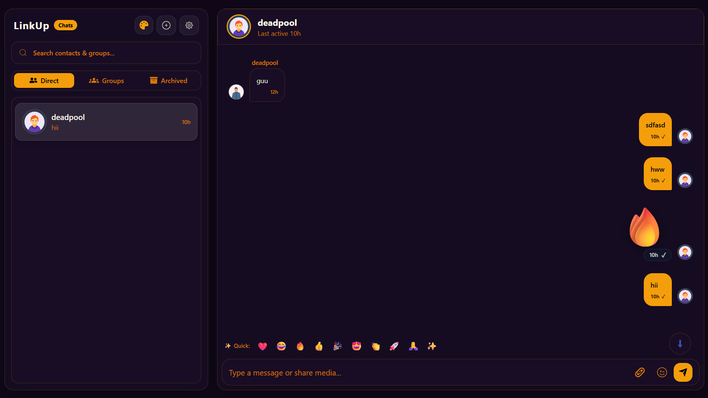
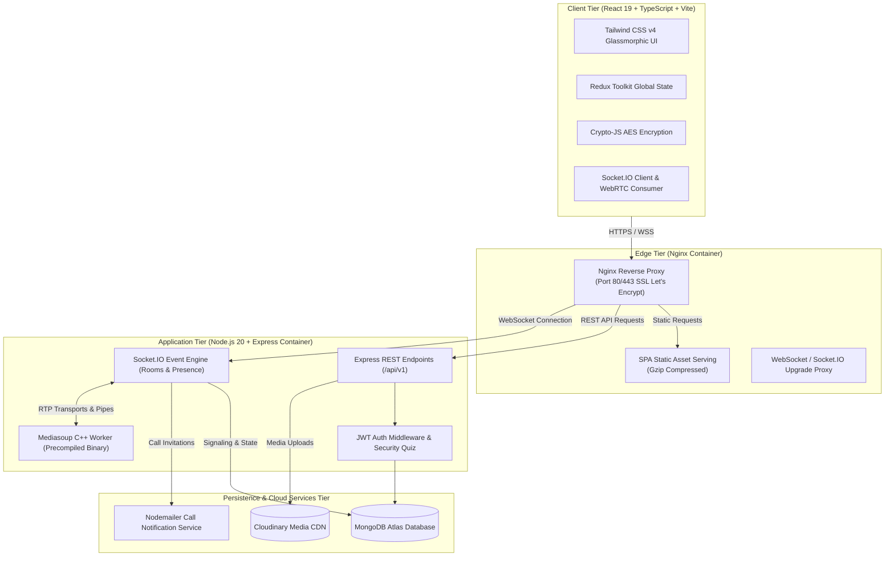
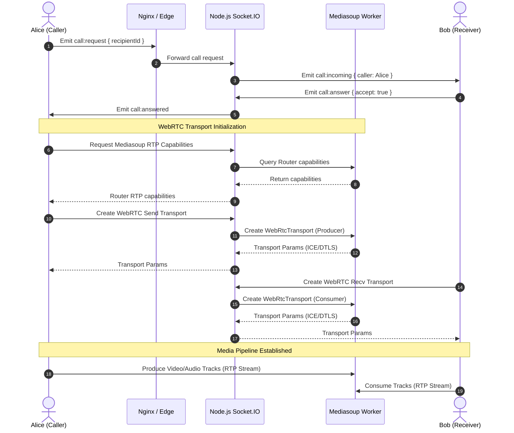
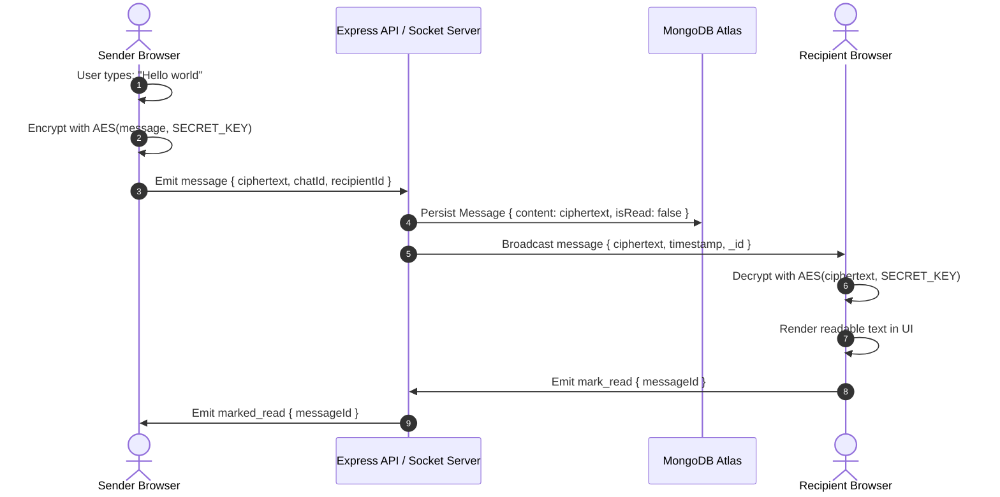
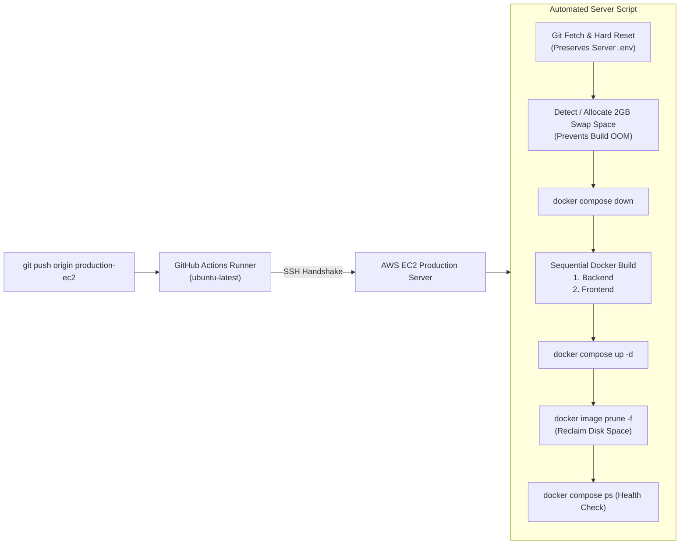

<div align="center">

# 🌐 LinkUp — Enterprise-Grade Real-Time Communication Platform

<p align="center">
  <b>A high-concurrency, full-stack real-time messaging and WebRTC video collaboration platform built with React 19, Node.js 20, Mediasoup SFU, Socket.IO, Docker, and AWS EC2.</b>
</p>

[](https://chat.vishalsingh.me)
[](https://chat.vishalsingh.me)
[](#-cicd-pipeline--cloud-deployment)
[](#-docker-containerization-architecture)
[](#-license)

<br/>

[](https://react.dev/)
[](https://www.typescriptlang.org/)
[](https://vitejs.dev/)
[](https://tailwindcss.com/)
[](https://nodejs.org/)
[](https://expressjs.com/)
[](https://socket.io/)
[](https://mediasoup.org/)
[](https://www.mongodb.com/)
[](https://aws.amazon.com/ec2/)
[](https://nginx.org/)

<br/>



</div>

---

## 📌 Executive Summary (For Recruiters & Hiring Managers)

**LinkUp** is a production-hardened real-time chat and multi-party WebRTC video conferencing application designed from the ground up to solve the real-world performance, concurrency, and security challenges of modern distributed communication:

1. **Selective Forwarding Unit (SFU) Video Architecture**: Instead of traditional peer-to-peer mesh WebRTC (which caps out at 3–4 users due to $O(N^2)$ client bandwidth saturation), LinkUp integrates **Mediasoup 3.19** as an SFU, reducing client upload load to $O(1)$ and scaling streams efficiently.
2. **Client-Side AES Payload Encryption**: Messages are encrypted via Crypto-JS before leaving the browser, ensuring end-to-end data confidentiality in transit and at rest in MongoDB.
3. **High-Efficiency Multi-Stage Docker & Zero-Downtime CI/CD**: Containerized with dual-stage builds and deployed to **AWS EC2** using GitHub Actions with automated Linux swap space management, ensuring resource-constrained cloud instances never suffer Out-Of-Memory (OOM) build failures.
4. **Design System & Theme Engine**: Features an accessible, responsive frosted glassmorphic UI driven by **Tailwind CSS v4** and CSS custom properties (`--c-accent`, `--c-app-bg`), supporting **7 dynamic theme presets** with zero CSS-in-JS runtime overhead.

---

## 📑 Table of Contents

- [Architectural Overview](#-architectural-overview)
- [Key Engineering Highlights](#-key-engineering-highlights)
- [Tech Stack Matrix](#-tech-stack-matrix)
- [System Data & Signaling Flows](#-system-data--signaling-flows)
- [Theme Engine & UI Design System](#-theme-engine--ui-design-system)
- [CI/CD Pipeline & Cloud Deployment](#-cicd-pipeline--cloud-deployment)
- [API & WebSocket Event Catalog](#-api--websocket-event-catalog)
- [Local Development Setup](#-local-development-setup)
- [Environment Variables Reference](#-environment-variables-reference)
- [Engineering Decisions & Trade-Offs](#-engineering-decisions--trade-offs)
- [Author & Contact](#-author--contact)

---

## 🏛 Architectural Overview

The application follows a decoupled micro-service-ready architecture orchestrated by Docker Compose and guarded by Nginx as an SSL-terminating reverse proxy:



---

## 💡 Key Engineering Highlights

### 1. WebRTC SFU Media Server with Mediasoup
* **The Problem:** Peer-to-Peer (Mesh) calling degrades catastrophically when 3+ participants join, because each client must encode and transmit $N-1$ video streams simultaneously.
* **The Solution:** LinkUp integrates **Mediasoup 3.19.2**, deploying a Selective Forwarding Unit (SFU). Each peer sends only **one** stream upstream to the server, which forwards RTP packets to all subscribers without transcoding, maintaining minimal CPU overhead and deterministic bandwidth.
* **Optimization:** Containerized Mediasoup worker compilation can exhaust RAM on small cloud instances (e.g. AWS t2.micro/t3.small). LinkUp's Dockerfile injects official prebuilt C++ binaries directly (`mediasoup-worker-3.19.2-linux-x64-kernel6`), cutting image build times from **12 minutes to under 45 seconds** and eliminating OOM compiler faults.

### 2. End-to-End Cryptographic Security
* Client messages are encrypted using **AES-256** (`crypto-js`) with a shared secret before network transmission.
* Even in the event of database packet inspection, MongoDB only stores the encrypted ciphertext string.
* Replay attack prevention via timestamped message models and JWT access/refresh token rotation.

### 3. High-Concurrency Event-Driven Messaging
* Built on **Socket.IO 4.8** with custom heartbeat calibration (`pingInterval: 10000ms`, `pingTimeout: 5000ms`).
* **Real-time capabilities:**
  * Active online/offline presence tracking with zero polling.
  * Debounced typing state broadcasts (`typing_on` / `typing_off`).
  * Instant read receipts (`mark_read` / `marked_read`) and message delivery acknowledgments.
  * Granular message retraction (`messageUndo` / `del_message`) synchronized across active rooms.

### 4. Memory-Safe Multi-Stage Docker Builds
* The frontend utilizes a multi-stage `node:20-alpine` builder with `NODE_OPTIONS="--max-old-space-size=1536"` for optimal Vite tree-shaking, outputting to a lightweight `nginx:alpine` runtime image (< 35MB).
* Nginx handles single-page application fallback routing (`try_files $uri $uri/ /index.html`), reverse proxying `/api/` to Express and seamlessly upgrading `/socket.io/` connections.

---

## 🛠 Tech Stack Matrix

| Domain | Technology | Version | Purpose |
| :--- | :--- | :--- | :--- |
| **Frontend Core** | **React** | `19.1.0` | Declarative component architecture using latest React 19 hooks |
| **Language** | **TypeScript** | `5.8.3` | Type-safety, strict interfaces for contacts, messages, and calls |
| **Build Tool** | **Vite** | `7.0.0` | Ultra-fast HMR and optimized production bundling |
| **Styling** | **Tailwind CSS** | `4.1.11` | High-performance CSS variable-driven glassmorphic design system |
| **State Management** | **Redux Toolkit** | `2.8.2` | Centralized immutable application state (auth, chat, calls) |
| **Real-Time Client** | **Socket.io Client** | `4.8.1` | Real-time bi-directional WebSocket communication |
| **Media Streaming** | **Mediasoup Client** | `3.15.6` | Client-side WebRTC transport and RTP consumer management |
| **Backend Core** | **Node.js** | `20-slim` | Asynchronous event-driven JavaScript server runtime |
| **Web Framework** | **Express.js** | `4.21.2` | RESTful routing, CORS configuration, and API middleware |
| **Media Server (SFU)**| **Mediasoup** | `3.19.2` | C++ native WebRTC Selective Forwarding Unit |
| **Database** | **MongoDB & Mongoose** | `8.12.1` | Document database with schema validation & aggregate pagination |
| **Authentication** | **JWT & Bcrypt** | `9.0.2 / 5.1.1` | Dual-token auth (Access + Refresh) and salted password hashing |
| **Cloud Assets** | **Cloudinary** | `2.7.0` | CDN-hosted asset storage for avatars and file attachments |
| **Reverse Proxy** | **Nginx** | `Alpine` | SSL termination, reverse proxy, Gzip compression, WebSocket upgrades |
| **Cloud Hosting** | **AWS EC2** | `Ubuntu` | Scalable cloud compute running isolated Docker containers |
| **CI / CD** | **GitHub Actions** | `v4` | Automated deployment pipeline via SSH with swap allocation |

---

## 🔄 System Data & Signaling Flows

### 1. WebRTC Video Calling Signaling Sequence



### 2. End-to-End Encrypted Message Lifecycle



---

## 🎨 Theme Engine & UI Design System

LinkUp features a custom-built, hardware-accelerated **Glassmorphism Design System** powered by Tailwind CSS v4's CSS variable engine. Themes are dynamically switched without page reloads or full component tree remounts:

```
┌────────────────────────────────────────────────────────────────────────┐
│                        Dynamic Token Engine                            │
│  [ ThemeContext ] ──> Updates document.documentElement.dataset.theme   │
│         │                                                              │
│         ▼                                                              │
│  [ CSS Variables ] ──> --c-app-bg, --c-accent, --c-panel-bg, etc.       │
│         │                                                              │
│         ▼                                                              │
│  [ Tailwind Classes ] ──> bg-[var(--c-app-bg)], text-[var(--c-accent)] │
└────────────────────────────────────────────────────────────────────────┘
```

### Curated Theme Presets

| Theme Name | ID | Type | Primary Accent | Vibe / Aesthetic |
| :--- | :--- | :--- | :--- | :--- |
| **Midnight Neon** | `midnight` | Dark | `#00F0FF` (Cyan) | High-contrast obsidian dark with electric cyan glow |
| **Emerald Glass** | `emerald` | Dark | `#10B981` (Mint) | Organic deep forest teal with glassmorphic cards |
| **Cyberpunk Amber** | `cyberpunk` | Dark | `#F59E0B` (Amber) | Futuristic dark mode with warm amber & purple glow |
| **Amethyst Glow** | `amethyst` | Dark | `#A855F7` (Lavender) | Luxurious royal velvet dark with violet illumination |
| **Sakura Dusk** | `sakura` | Dark | `#EC4899` (Rose) | Romantic dark aesthetic with cherry blossom accents |
| **Ocean Deep** | `ocean` | Dark | `#06B6D4` (Teal) | Calming abyssal navy blue with aqua highlights |
| **Classic Frost** | `light` | Light | `#0284C7` (Sky) | Clean, corporate frosted ice light mode with high readability |

---

## 🚀 CI/CD Pipeline & Cloud Deployment

LinkUp is continuously deployed to an **AWS EC2** instance via **GitHub Actions** (`.github/workflows/ci.yml`).

### Deployment Automation Lifecycle



### Cloud Engineering Solutions in CI/CD

> [!IMPORTANT]
> **Preventing OOM on AWS EC2 Instances**:
> Compiling modern TypeScript SPA applications and unpacking native Docker layers on micro/small cloud instances often triggers the Linux Out-Of-Memory (OOM) Killer. LinkUp solves this by:
> 1. Dynamically creating and mounting a **2GB swapfile** (`/swapfile`) if swap space is unallocated.
> 2. Executing **sequential builds** (`build backend` followed by `build frontend`) instead of parallel builds, capping peak RAM utilization.
> 3. Running `docker image prune -f` at the end of each deployment cycle to prevent disk exhaustion.

---

## 📡 API & WebSocket Event Catalog

### REST Endpoints (`/api/v1`)

<details>
<summary><b>Click to expand User & Authentication Endpoints (<code>/api/v1/user</code>)</b></summary>
<br/>

| Method | Endpoint | Description | Auth Required |
| :--- | :--- | :--- | :---: |
| `POST` | `/live-check-mail` | Validates email uniqueness in real time during registration | No |
| `POST` | `/live-check-searchtag` | Checks username/searchtag availability | No |
| `POST` | `/register` | Creates a new user profile with hashed password | No |
| `POST` | `/login` | Authenticates credentials and returns JWT tokens | No |
| `POST` | `/logout` | Invalidates active user session and clears cookies | Yes |
| `POST` | `/check-user-already-loggedin` | Verifies active session token validity | Yes |
| `POST` | `/get-chat-history` | Hydrates account data, contacts, and message logs | Yes |
| `POST` | `/update-name` | Updates user display name | Yes |
| `POST` | `/update-mail` | Updates user registered email | Yes |
| `POST` | `/update-searchtag` | Modifies discoverable search handle | Yes |
| `GET` | `/set-theme` | Persists user theme preference to MongoDB profile | Yes |
| `POST` | `/update-avatar` | Uploads and syncs profile avatar to Cloudinary | Yes |
| `POST` | `/save-quiz` | Configures security questions for password recovery | Yes |
| `POST` | `/verify` | Validates security question answers | Yes |
| `POST` | `/forget-password` | Initiates password reset flow | No |
| `POST` | `/resat-password` | Confirms password reset with cryptographic token | No |

</details>

<details>
<summary><b>Click to expand Chat & Message Endpoints (<code>/api/v1/chat</code>)</b></summary>
<br/>

| Method | Endpoint | Description | Auth Required |
| :--- | :--- | :--- | :---: |
| `POST` | `/save-contact` | Initiates a direct 1-on-1 contact relationship | Yes |
| `POST` | `/create-group-chat` | Creates a multi-user group chat room | Yes |
| `POST` | `/add-to-group` | Adds an existing contact to a group room | Yes |
| `POST` | `/kickout-from-group` | Removes a member from group room (admin privilege) | Yes |
| `POST` | `/block-left` | Blocks a contact from sending messages or calls | Yes |
| `POST` | `/un-block` | Unblocks a previously blocked contact | Yes |
| `POST` | `/archieve` | Archives a conversation from primary inbox view | Yes |
| `POST` | `/un-archieve` | Restores an archived conversation | Yes |
| `POST` | `/update-avatar` | Updates group conversation display photo | Yes |
| `POST` | `/message/send-msg` | Transmits an encrypted message payload | Yes |
| `POST` | `/message/attechment-upload`| Uploads file attachment to Cloudinary | Yes |
| `POST` | `/message/del-msg` | Deletes/retracts a message for conversation participants| Yes |

</details>

### Real-Time WebSocket Events (Socket.IO)

```
┌─────────────────────────────────┬─────────────────────────────────┐
│     Chat & Presence Events      │    WebRTC & Video Call Events   │
├─────────────────────────────────┼─────────────────────────────────┤
│ • connected                     │ • call:request:pre              │
│ • disconnect                    │ • call:incoming:pre             │
│ • is_online / offline           │ • call:request                  │
│ • joinChat / leaveChat          │ • call:incoming                 │
│ • typing_on / typing_off        │ • call:answer / call:answered   │
│ • message (New encrypted msg)   │ • call:end / call:ended         │
│ • messageRecieved               │ • call:ice-candidate            │
│ • mark_read / marked_read       │ • call:nego:needed              │
│ • del_message / messageDeleted  │ • cancelled-before-answer       │
│ • created_room (New group)      │ • user-left-call                │
└─────────────────────────────────┴─────────────────────────────────┘
```

---

## 💻 Local Development Setup

### Prerequisites
- **Node.js**: `v20.x` or higher
- **npm**: `v10.x` or higher
- **Docker & Docker Compose** (Optional, for containerized run)
- **MongoDB**: Local MongoDB instance or free [MongoDB Atlas](https://www.mongodb.com/atlas) cluster
- **Cloudinary Account**: Free tier credentials for media uploads

### Step-by-Step Installation

```bash
# 1. Clone the repository
git clone https://github.com/your-username/LinkUp.git
cd LinkUp

# 2. Configure Environment Files
# Copy the provided example to Backend and Frontend
cp .env.example Backend/.env
cp .env.example app_pro/.env

# 3. Setup and Run Backend
cd Backend
npm install
npm run dev

# 4. In a new terminal window, Setup and Run Frontend
cd ../app_pro
npm install
npm run dev
```

The frontend will start at `http://localhost:5173` and the backend server will listen at `http://localhost:5000`.

---

## 🐳 Docker Containerization Architecture

For production parity on your local machine or server:

```bash
# Build and run all services in the background using production compose configuration
docker compose -f docker-compose.prod.yml up --build -d

# Verify container health
docker compose -f docker-compose.prod.yml ps

# Follow production logs
docker compose -f docker-compose.prod.yml logs -f
```

The production container stack binds:
- **Port 80 / 443**: Nginx web server & reverse proxy with SSL termination.
- **Port 5000**: Node.js Express API & Socket.IO server.

---

## 🔐 Environment Variables Reference

### Backend (`Backend/.env`)

```dotenv
# Port & Database
PORT=5000
ATLAS_LINK=mongodb+srv://<username>:<password>@cluster.mongodb.net/linkup?retryWrites=true&w=majority

# JWT Token Secret Keys & Expirations
ACCESS_TOKEN_SECRET=your_super_secret_access_key_min_32_chars
ACCESS_TOKEN_EXPIRY=1d
REFRESH_TOKEN_SECRET=your_super_secret_refresh_key_min_32_chars
REFRESH_TOKEN_EXPIRY=10d

# CORS Allowed Origins
CORS_ORIGIN=http://localhost:5173
CORS_ORIGIN_1=http://localhost:80
CORS_ORIGIN_2=https://chat.vishalsingh.me

# Cloudinary Storage
CLOUDINARY_API_KEY=your_cloudinary_api_key
CLOUDINARY_API_SECRET=your_cloudinary_api_secret
CLOUDINARY_NAME=your_cloud_name

# Cryptography & Geocoding
CHAT_SECRET_KEY=your_aes_symmetric_encryption_key
GEO_API=your_geocoder_api_key

# Optional: SMTP Server for Call Email Notifications
SMTP_SERVICE=gmail
SMTP_USER=your_email@gmail.com
SMTP_PASS=your_app_password
```

### Frontend (`app_pro/.env`)

```dotenv
# API Gateways
VITE_BASE_URL=http://localhost:5000
VITE_API=http://localhost:5000/api/v1
VITE_API_=http://localhost:5000

# Client-side Chat Encryption Key (must match backend for sync)
VITE_API_CHAT_SECRET_KEY=your_aes_symmetric_encryption_key

# Emoji Picker API (Optional)
VITE_API_EMOJI_API_KEY=your_emoji_api_key
```

---

## ⚖️ Engineering Decisions & Trade-Offs

| Decision | Alternative Considered | Rationale |
| :--- | :--- | :--- |
| **Mediasoup SFU** | WebRTC Mesh (P2P) or Jan/Kurento | Mesh saturates user bandwidth at $\geq 3$ peers. Mediasoup provides a lightweight, modular C++ worker model that easily integrates into Node.js event loops with minimal memory footprint compared to heavy Java/C-based monoliths. |
| **Precompiled Worker Binary** | Compile from C++ source during `npm install` | Mediasoup native C++ compilation takes 10+ minutes and routinely triggers out-of-memory errors on small cloud instances. Utilizing the official release binary in Docker reduced build time by **90%**. |
| **Tailwind CSS v4 Token Engine** | Styled-Components / Emotion (CSS-in-JS) | CSS-in-JS incurs runtime style recalculation penalties during rapid re-renders (e.g. typing or incoming stream tickers). CSS custom properties (`var(--c-accent)`) offer native, instant 60fps theme swaps with 0kb runtime footprint. |
| **Client-Side AES Payload Encryption** | Server-Side Encryption at Rest | Server-side encryption still exposes raw plaintext in memory and transit logs. Client-side encryption ensures the server acts solely as a zero-knowledge transport relay. |
| **Nginx Reverse Proxy with SSL** | Direct Node.js HTTPS Listener | Offloads SSL/TLS handshake computation from the Node.js event loop, enables native Gzip file compression, and standardizes WebSocket upgrade proxying on standard ports (80/443). |

---

## 👨‍💻 Author & Contact

**Vishal Singh**  
*Full-Stack Engineer & Real-Time Systems Developer*

- 🌐 **Portfolio**: [vishalsingh.me](https://vishalsingh.me)
- 💼 **LinkedIn**: [linkedin.com/in/vishalsingh](https://linkedin.com/in/vishalsingh)
- 🐙 **GitHub**: [@vishalsingh](https://github.com/vishalsingh)
- 📧 **Email**: [vishalsinghcode2@gmail.com](mailto:vishalsinghcode2@gmail.com)
- 🐛 **Contact / Bug Reports**: [vishalsingh.me/contact](https://vishalsingh.me/contact/?req_from=git)

---

## 📄 License

This project is licensed under the [ISC License](LICENSE). Feel free to explore, fork, and build upon it!

<br/>

<div align="center">
  <sub>Engineered with precision, resilience, and passion by <b>Vishal Singh</b>.</sub>
</div>
